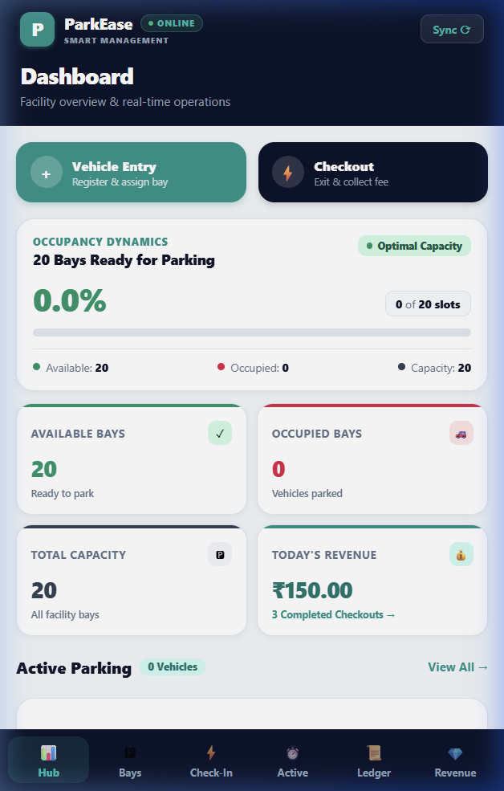
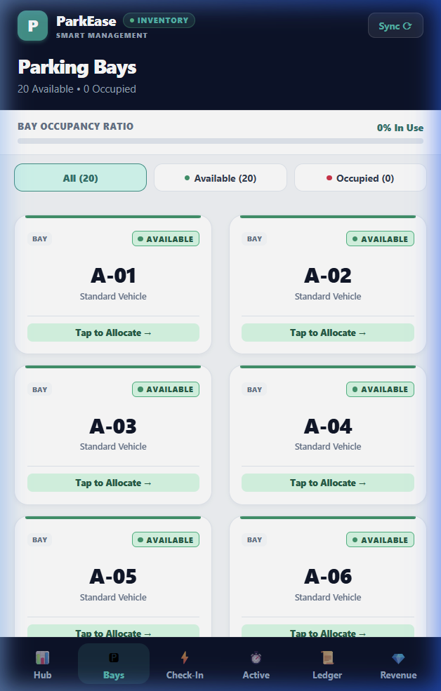
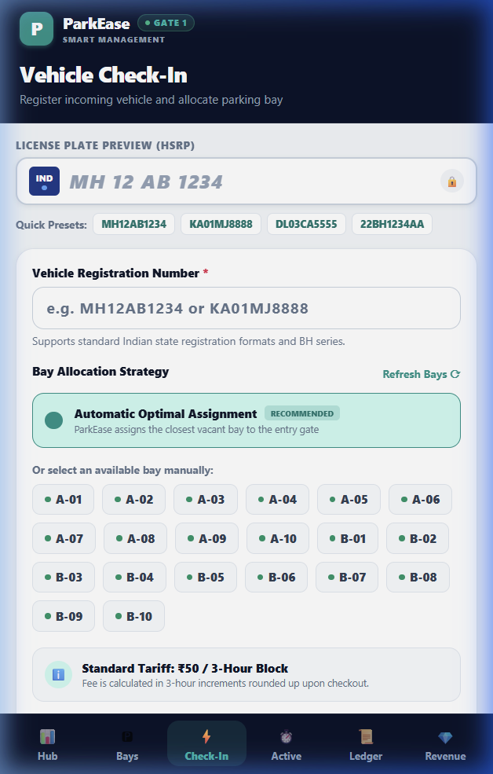
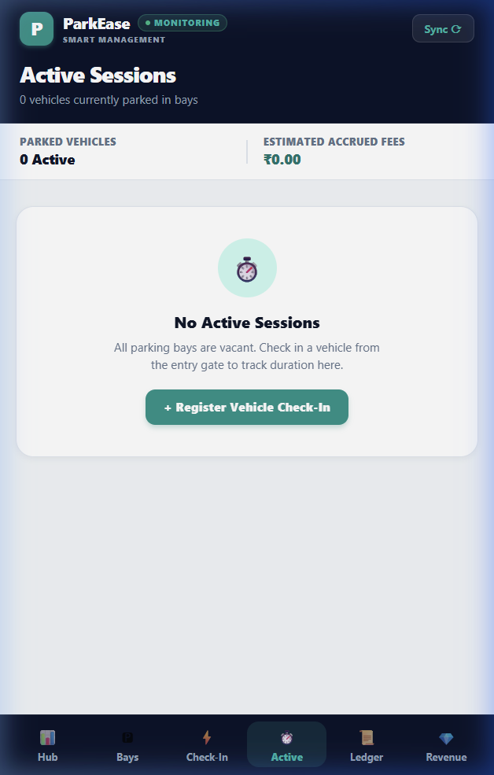
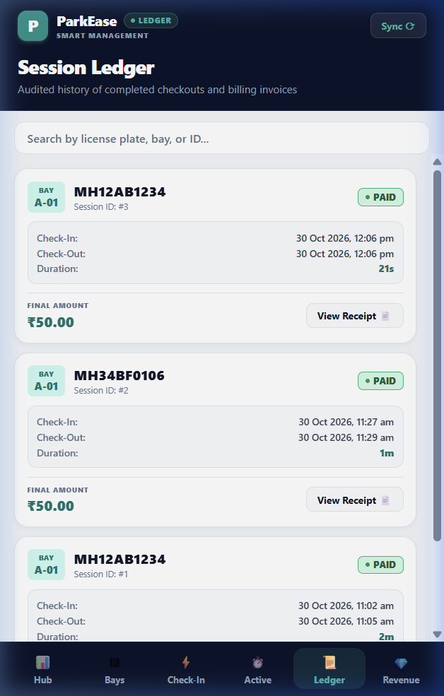
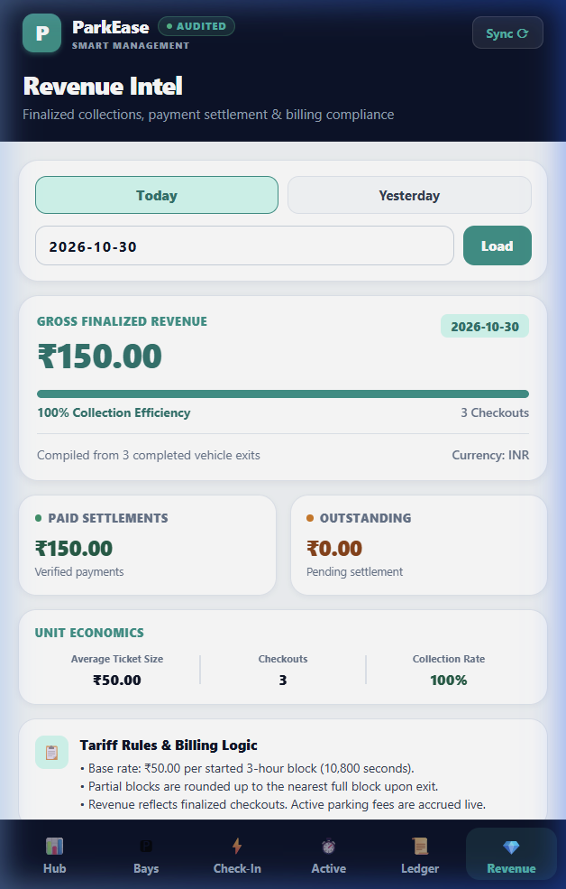
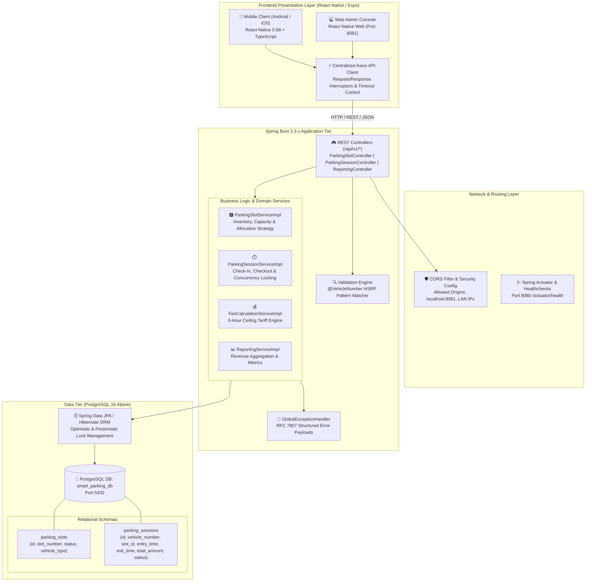
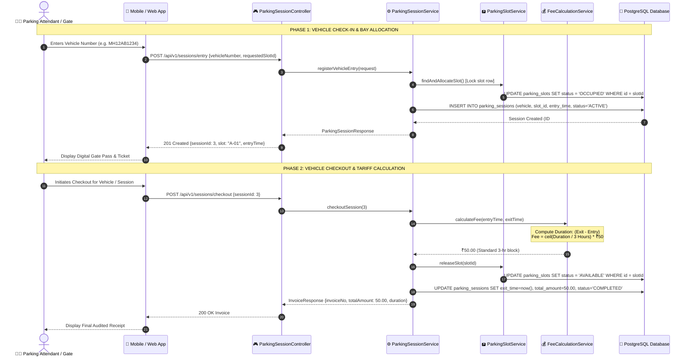
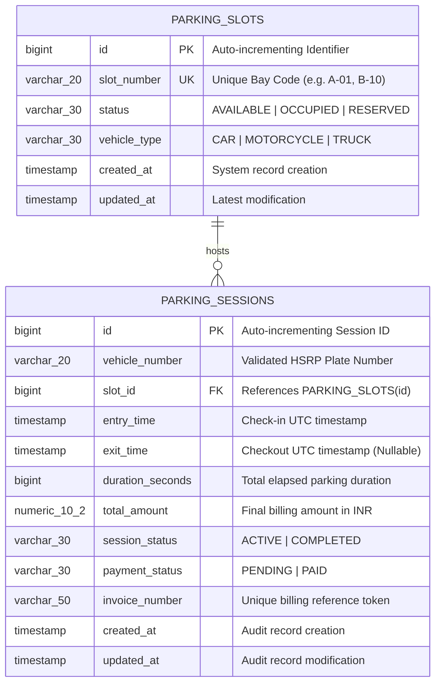
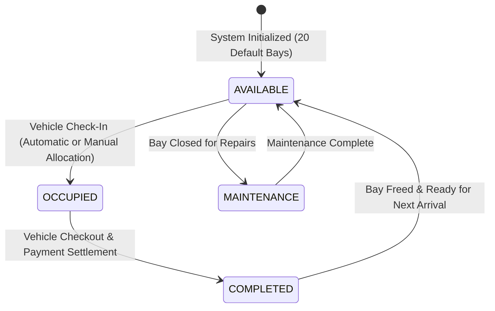

# 🅿️ ParkEase — Smart Parking Management System

[](https://spring.io/projects/spring-boot)
[](https://reactnative.dev/)
[](https://expo.dev/)
[](https://www.postgresql.org/)
[](https://www.docker.com/)
[](LICENSE)

An enterprise-grade, full-stack **Smart Parking Management Application** built with **Spring Boot 3**, **React Native / Expo Web**, and **PostgreSQL**. Designed for commercial parking lots, airports, shopping complexes, and urban transit hubs, ParkEase automates vehicle check-ins, dynamic bay allocations, real-time occupancy monitoring, automated tariff calculation (3-hour block blocks), and audited billing ledgers.

---

## 📑 Table of Contents

- [Application Screenshots & Walkthrough](#-application-screenshots--walkthrough)
- [System Architecture](#-system-architecture)
  - [High-Level Architecture Diagram](#1-high-level-architecture-diagram)
  - [Vehicle Check-In & Checkout Sequence Flow](#2-vehicle-check-in--checkout-sequence-flow)
  - [Entity Relationship Diagram (ERD)](#3-entity-relationship-diagram-erd)
  - [Parking Bay State Machine](#4-parking-bay-state-machine)
- [Key Features](#-key-features)
- [Tariff & Billing Model](#-tariff--billing-model)
- [Technology Stack](#-technology-stack)
- [API Reference](#-api-reference)
- [Directory Structure](#-directory-structure)
- [Getting Started](#-getting-started)
  - [Prerequisites](#prerequisites)
  - [Option A: Running with Docker Compose (Recommended)](#option-a-running-with-docker-compose-recommended)
  - [Option B: Running Locally (Manual Setup)](#option-b-running-locally-manual-setup)
- [Environment Variables](#-environment-variables)
- [Verification & Health Checks](#-verification--health-checks)

---

## 📸 Application Screenshots & Walkthrough

The following captures demonstrate the live user experience across all six core modules of the application:

| 1. Executive Hub (Dashboard) | 2. Bay Inventory Management |
|:---:|:---:|
|  |  |
| **Real-Time Facility Command Hub**<br>Live occupancy rate (`0.0%`), real-time bay counters (Available: `20`, Occupied: `0`), today's gross revenue metrics, and instantaneous single-tap action cards. | **Dynamic Bay Inventory Grid**<br>Categorized visual map of all bays (`A-01` to `B-10`), segmented availability filters (*All*, *Available*, *Occupied*), and direct bay reservation dispatch. |

| 3. Vehicle Check-In Terminal | 4. Active Parking Surveillance |
|:---:|:---:|
|  |  |
| **HSRP Indian License Plate Check-In**<br>Compliant with Indian High Security Registration Plate (HSRP) formats & BH series. Features quick presets, automated closest-bay allocation, and manual overrides. | **Live Vehicle Duration & Fee Tracker**<br>Tracks live parked vehicles, active session timers, bay allocations, and accrued real-time parking fee estimations. |

| 5. Audited Session Ledger | 6. Revenue Intelligence & Analytics |
|:---:|:---:|
|  |  |
| **Tamper-Evident Historical Audit Log**<br>Searchable log by vehicle registration number or session ID. Displays check-in/out timestamps, exact duration, payment status badge, and printable invoices. | **Settlement & Daily Revenue Analytics**<br>Daily gross revenue auditing, 100% collection efficiency verification, average ticket size economics, and comprehensive billing rule policies. |

---

## 🏗️ System Architecture

ParkEase adheres to a robust, scalable, decoupled 3-tier architecture with transactional consistency, ACID compliance, and reactive frontend updates.

### 1. High-Level Architecture Diagram



---

### 2. Vehicle Check-In & Checkout Sequence Flow



---

### 3. Entity Relationship Diagram (ERD)



---

### 4. Parking Bay State Machine



---

## ⚡ Key Features

- **Executive Fleet Dashboard**: Real-time overview of current capacity, occupancy percentages, and revenue generated on the active day.
- **Smart Bay Allocator**: Automatically allocates the optimal and closest bay upon arrival, with the ability to manually override with any vacant slot.
- **Indian HSRP License Plate Engine**: Validates registration formats (standard state plates e.g. `MH12AB1234`, `DL03CA5555`, and Government Bharat Series `22BH1234AA`).
- **Live Active Parking Surveillance**: Dynamic duration timer and real-time accrued fare estimates before checkout.
- **Accurate Tariff Engine**: Automated tiered pricing model with 3-hour blocks and upward ceiling rounding.
- **Audited Session Ledger**: Searchable historical ledger with full audit trails, check-in/out timestamps, and receipt modals.
- **Revenue Intelligence**: Day-level revenue aggregation with collection efficiency rates and ticket analytics.
- **Resilient Mobile & Web Compatibility**: Single codebase running seamlessly on Android, iOS, and Desktop / Tablet browsers via React Native Web.

---

## 💵 Tariff & Billing Model

The tariff computation engine operates on an incremental block model designed for fair and automated commercial parking:

$$\text{Blocks} = \left\lceil \frac{\text{Duration in Seconds}}{10,800\text{ seconds}} \right\rceil = \left\lceil \frac{\text{Duration in Hours}}{3} \right\rceil$$

$$\text{Total Fee} = \max(1, \text{Blocks}) \times ₹50.00$$

| Parking Duration | Calculated Blocks | Applicable Fee |
| :--- | :---: | :---: |
| 0 to 3 Hours (1 – 180 min) | 1 Block | **₹50.00** |
| 3 Hours 1 Min to 6 Hours | 2 Blocks | **₹100.00** |
| 6 Hours 1 Min to 9 Hours | 3 Blocks | **₹150.00** |
| Every additional 3-hour block | +1 Block | **+₹50.00** |

*Note: Any fractional block duration is rounded up to the nearest completed 3-hour interval.*

---

## 🛠️ Technology Stack

| Layer | Technologies |
| :--- | :--- |
| **Frontend Framework** | [React Native](https://reactnative.dev/) (0.88), [Expo](https://expo.dev/) (v58), [React Native Web](https://necolas.github.io/react-native-web/) (0.21) |
| **Frontend Language** | [TypeScript](https://www.typescriptlang.org/) (Strict Mode) |
| **Networking** | [Axios](https://axios-http.com/) with custom interceptors and error transformers |
| **Backend Framework** | [Spring Boot](https://spring.io/projects/spring-boot) 3.3.x, Spring MVC, Spring Data JPA |
| **Backend Language** | Java 17 / 21 |
| **Database** | [PostgreSQL 16](https://www.postgresql.org/) Alpine |
| **API Documentation** | [OpenAPI 3 / Swagger](https://swagger.io/) (`springdoc-openapi-starter-webmvc-ui`) |
| **Validation** | Jakarta Bean Validation, Custom Regex Constraint Validators |
| **Containerization** | Docker, Docker Compose multi-stage builds |

---

## 🔌 API Reference

Base Endpoint: `http://localhost:8080/api/v1`

### 1. Parking Slots (`/api/v1/slots`)
- `GET /api/v1/slots` — List all parking bays with live status.
- `GET /api/v1/slots/availability` — Summary counts (total, available, occupied, occupancy %).
- `GET /api/v1/slots/available` — Filter only available bays.
- `GET /api/v1/slots/occupied` — Filter only occupied bays.
- `GET /api/v1/slots/{slotId}` — Detailed metadata for a specific bay.

### 2. Parking Sessions (`/api/v1/sessions`)
- `POST /api/v1/sessions/entry` — Check-in vehicle and reserve slot.
- `GET /api/v1/sessions/active` — List all currently parked vehicles with live accrued fees.
- `GET /api/v1/sessions/active/{sessionId}` — Get single active session details.
- `POST /api/v1/sessions/checkout` — Check out vehicle, free bay, and calculate final fee.
- `GET /api/v1/sessions/history` — Paginated history of all sessions with search filters.
- `GET /api/v1/sessions/{sessionId}/invoice` — Fetch structured invoice data.

### 3. Revenue Reports (`/api/v1/reports`)
- `GET /api/v1/reports/revenue?date=YYYY-MM-DD` — Daily aggregated revenue and collection stats.

---

## 📁 Directory Structure

```text
Smart_Parking_app/
├── backend/
│   ├── src/main/java/com/parking/
│   │   ├── config/           # OpenAPI, CORS & app configurations
│   │   ├── controller/       # REST endpoints (Slots, Sessions, Reports)
│   │   ├── dto/              # Request / Response Transfer Objects
│   │   ├── entity/           # JPA Entities (ParkingSlot, ParkingSession)
│   │   ├── enums/            # SlotStatus, SessionStatus, PaymentStatus
│   │   ├── exception/        # Global Exception Handler & Domain Errors
│   │   ├── mapper/           # Entity to DTO mappers
│   │   ├── repository/       # Spring Data JPA Repositories
│   │   ├── service/          # Business logic & Fee calculation engine
│   │   └── validation/       # Indian HSRP Vehicle Number validator
│   ├── pom.xml               # Maven configuration
│   └── Dockerfile            # Multi-stage JDK container build
├── mobile/
│   ├── src/
│   │   ├── api/              # Axios client & typed API endpoints
│   │   ├── components/       # Custom Icons, Cards, Modals
│   │   ├── constants/        # Design system colors & endpoints
│   │   ├── screens/          # Dashboard, Slots, Entry, Active, Ledger, Revenue
│   │   └── types/            # TypeScript interfaces & models
│   ├── App.tsx               # Root component & multi-tab navigation
│   ├── package.json          # React Native dependencies
│   └── Dockerfile            # Expo Web container deployment
├── docs/
│   └── screenshots/          # High-resolution production app screenshots
├── docker-compose.yml        # Orchestration for DB, Backend & Frontend
└── README.md                 # System documentation & manual
```

---

## 🚀 Getting Started

### Prerequisites

Ensure the following tools are installed on your environment:
- [Docker Desktop](https://www.docker.com/products/docker-desktop/) (v24+)
- [Node.js](https://nodejs.org/) (v20+ recommended)
- [Java JDK](https://adoptium.net/) (17 or 21) & Maven 3.8+ (for local backend development)

---

### Option A: Running with Docker Compose (Recommended)

Start the entire stack (PostgreSQL, Spring Boot Backend, and Expo Web App) with a single command:

```bash
# From the project root (Smart_Parking_app)
docker compose up -d --build
```

#### Access Points:
- 📱 **Mobile Web Application**: [http://localhost:8081](http://localhost:8081)
- ⚙️ **Spring Boot REST API**: [http://localhost:8080](http://localhost:8080)
- 📖 **Swagger / OpenAPI Documentation**: [http://localhost:8080/swagger-ui.html](http://localhost:8080/swagger-ui.html)
- 🐘 **PostgreSQL Database**: `localhost:5432` (`smart_parking_db`)

To view live logs:
```bash
docker compose logs -f
```

To stop all services:
```bash
docker compose down
```

---

### Option B: Running Locally (Manual Setup)

#### 1. Start PostgreSQL
Ensure PostgreSQL is running on `localhost:5432` with a database named `smart_parking_db`:
```sql
CREATE DATABASE smart_parking_db;
```

#### 2. Start Spring Boot Backend
```bash
cd backend
# Run using Maven wrapper
./mvnw spring-boot:run
# On Windows PowerShell:
.\mvnw.cmd spring-boot:run
```
*The backend automatically creates tables and seeds initial parking bays `A-01` through `B-10` on startup.*

#### 3. Start Expo / React Native Frontend
```bash
cd mobile
npm install

# Start in Web mode
npx expo start --web

# Or start interactive Metro Bundler (for Android / iOS Expo Go)
npx expo start
```

---

## ⚙️ Environment Variables

### Backend Configuration (`backend/src/main/resources/application.properties` or Docker environment):

| Variable | Description | Default |
| :--- | :--- | :--- |
| `DATABASE_URL` | PostgreSQL JDBC Connection URL | `jdbc:postgresql://postgres:5432/smart_parking_db` |
| `DB_USERNAME` | Database User | `postgres` |
| `DB_PASSWORD` | Database Password | `swayam12` |
| `SERVER_PORT` | Spring Boot Listening Port | `8080` |

### Frontend Configuration (`mobile/src/constants/config.ts` or Docker environment):

| Variable | Description | Default |
| :--- | :--- | :--- |
| `EXPO_PUBLIC_API_URL` | Base URL of Spring Boot REST API | `http://localhost:8080` |
| `HOST_LAN_IP` | LAN IP of dev workstation for physical mobile devices | `10.78.168.205` |
| `PORT` | Expo web port | `8081` |

---

## 🩺 Verification & Health Checks

Verify your deployment with the following quick sanity checks:

```bash
# 1. Check Backend Actuator Health
curl http://localhost:8080/actuator/health
# Expected: {"status":"UP"}

# 2. Check Parking Bay Availability
curl http://localhost:8080/api/v1/slots/availability
# Expected: {"totalSlots":20,"availableSlots":20,"occupiedSlots":0,"occupancyRatePercent":0.0}

# 3. Check Daily Revenue Endpoint
curl http://localhost:8080/api/v1/reports/revenue
```

---

## 📄 License

This project is licensed under the MIT License — see the [LICENSE](mobile/LICENSE) file for details.
